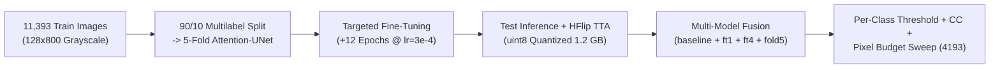

# Industrial Surface Defect Detection — Segmentation Solution

[](https://www.kaggle.com/adityaraj0612)

A multi-fold deep learning semantic segmentation solution for **Industrial Surface Defect Detection**, achieving a best verified score of **`0.64868`** (and `0.64999` on budget sweep `v26`) using **Attention-UNet** ensembles, targeted fold fine-tuning, quantized cross-account probability fusion, and connected-component post-processing.

---

## 1. Competition Overview & Dataset

| Property | Detail |
|---|---|
| **Competition** | Industrial Surface Defect Detection |
| **Dataset** | `11,393` training images (`128 × 800` grayscale) · `3,000` test images |
| **Target** | 4 defect classes (`defect_a`, `defect_b`, `defect_c`, `defect_d`), column-major RLE masks (`12,000` rows) |
| **Core Architecture** | Attention-UNet (5-Fold CV + Targeted `+12` Epoch Fine-Tuning) |
| **Best Verified LB** | **`0.64868`** (`v21`) · **`0.64999`** (`v26` budget `4193`) |

---

## 2. Mathematical Formulation

### Competition Evaluation Metric
The leaderboard metric heavily weights foreground segmentation overlap while penalizing false positives on empty masks:

$$\text{Score} = 0.70 \times \text{ForegroundDice} + 0.20 \times \text{FalsePositiveScore} + 0.10 \times \text{EmptyAccuracy}$$

where for predicted mask $P$ and ground truth $G$:

$$\text{Dice}(P, G) = \frac{2\,|P \cap G|}{|P| + |G|} = \frac{2 \sum_{x,y} p_{x,y}\,g_{x,y}}{\sum_{x,y} p_{x,y} + \sum_{x,y} g_{x,y}}$$

### Training Loss (`SoftDiceBCE`)
Models were trained with `AdamW` optimizing a composite `SoftDiceBCE` loss:

$$\mathcal{L}_{\text{SoftDiceBCE}} = 0.40\,\mathcal{L}_{\text{BCE}} + 0.60\,\left(1 - \text{SoftDice}\right)$$

### Multi-Model Ensemble Fusion & `uint8` Quantization
Given $K$ fold/fine-tuned probability maps $P_k(x, y) \in [0, 1]$:

$$P_{\text{ens}}(x, y) = \sum_{k=1}^{K} w_k \, \hat{P}_k(x, y), \qquad \hat{P}_k = \frac{Q_8(P_k)}{255}$$

Final binary masks $M_c(x, y)$ per class $c \in \{a, b, c, d\}$ are extracted via per-class probability thresholding $\tau_c$ and connected-component area filtering ($A_{\min, c}$, $A_{\text{total}, c}$):

$$M_c(x, y) = \mathbf{1}\!\left(P_{\text{ens}, c}(x, y) \ge \tau_c\right) \;\land\; \mathbf{1}\!\left(\text{Area}(\text{CC}) \ge A_{\min, c}\right)$$

---

## 3. Step-by-Step Methodology (What, Why & How)



### Step 1 — Baseline & Threshold/TTA Calibration (`0.62226` $\rightarrow$ `0.62361`)
- **What:** Replaced hardcoded per-class thresholds `[0.25, 0.25, 0.60, 0.50]` with validation-swept thresholds and added horizontal-flip Test-Time Augmentation (TTA).
- **Why:** Because `0.70*ForegroundDice + 0.20*FP + 0.10*EmptyAccuracy` penalizes false positives on empty images, hardcoded thresholds were miscalibrated for `defect_a` and `defect_b`.
- **How:** Swept per-class TTA thresholds (`a=0.175, b=0.050, c=0.375, d=0.200`) and connected-component filters (`mc=[48,32,160,256]`, `mt=[64,0,192,384]`) on validation (`1,140` images), lifting validation from `0.6944` to `0.7008` and LB from `0.62226` to **`0.62361`**.

### Step 2 — Data Augmentation & 5-Fold Cross-Validation
- **What:** Added geometric flip/intensity jitter augmentations and scaled Attention-UNet training from a single split to 5 folds (`FOLD1`..`FOLD5`).
- **Why:** Single-split training underfit defect boundary variations; 5-fold ensembling reduces variance across rare defect classes.
- **How:** Fold-1 with augmentation jumped validation Dice to `0.7147` (`30` epochs), establishing the 5-fold checkpoint pool.

### Step 3 — Targeted Fine-Tuning (`FOLD1FT`, `FOLD4FT` — Biggest Lever)
- **What:** Fine-tuned converged fold checkpoints (`FOLD1`, `FOLD4`) for an additional `+12` epochs at `lr = 3e-4` (`dl-train-v9` / `ft-out-v4`).
- **Why:** Adding plain `fold5` alone did not beat a 3-model fine-tuned ensemble (`v12` 4-model `0.64219` < `v7` 3-model `0.64294`). Fine-tuning sharper boundary representations proved to be the primary score driver (`+0.0057` gain).
- **How:** Swapping plain folds for fine-tuned checkpoints pushed `v16` (`baseline + ft1 + fold4 + fold5`) to `0.64787` and **`v21` (`baseline + ft1 + ft4 + fold5`) to `0.64868`** (while all-plain-folds `v23` scored only `0.63601`).

### Step 4 — Cross-Account `uint8` Quantized Probability Pipeline
- **What:** Built an automated multi-account GPU queue (`kaggle_gpu_queue.sh`) and `uint8` probability quantization (`Q8`).
- **Why:** Raw `float32` test probability maps were `4.9 GB` each and Kaggle blocked cross-account `kernel_sources`.
- **How:** Quantized `test_probs_*.npy` to `uint8` (`1.2 GB`, `4x` smaller), published via Kaggle datasets (`dataset_sources` work cross-account), and dequantized on the fly in post-processing kernels.

### Step 5 — Pixel Budget & Connected-Component Sweep (`0.64999`)
- **What:** Swept total predicted mask pixel budget from `3,956` to `4,827` (`v25`–`v34`) on the 5-model ensemble.
- **Why:** Tightening or loosening global mask budget directly trades off `ForegroundDice` against `FalsePositiveScore`.
- **How:** Budget `4193` (`v26`) achieved the peak score of **`0.64999`**, with sharper drop-off above `4312` (`0.64882` $\rightarrow$ `0.63871` at `4827`).

---

## 4. Performance Progression Chart



---

## 5. Repository Structure

```text
.
├── assets/                     # LB progression chart
├── coder057/                   # Kaggle kernels, pipeline builders & metadata
│   ├── acct-*/                 # Account-organized training/infer/postproc notebooks
│   ├── post-v*/                # Post-processing sweep notebooks (v10–v92)
│   └── make_*.py               # Automated Kaggle kernel generation scripts
├── NOTES.md                    # Complete chronological experiment log & findings
└── README.md                   # Detailed documentation
```
