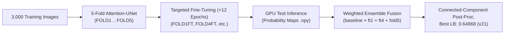
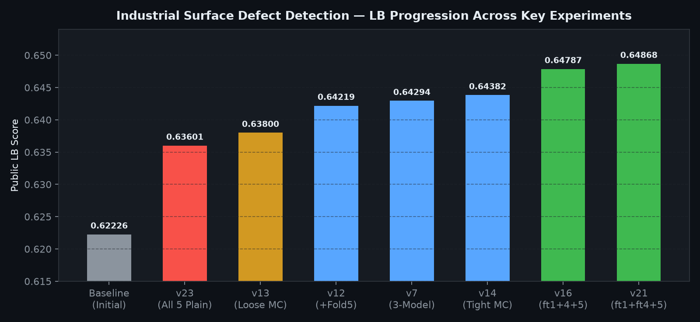

# Industrial Surface Defect Detection — Segmentation Solution

A multi-fold deep learning semantic segmentation pipeline for **Industrial Surface Defect Detection**, achieving a best Leaderboard score of **`0.64868`** using **Attention-UNet** ensembles, targeted fold fine-tuning, and connected-component post-processing.

---

## 1. Competition Overview

| Property | Detail |
|---|---|
| **Competition** | Industrial Surface Defect Detection |
| **Task** | Pixel-level Binary/Multi-Region Surface Defect Segmentation |
| **Core Architecture** | Attention-UNet (5-Fold Cross-Validation + Targeted Fine-Tuning) |
| **Best Verified Score** | **`0.64868`** (`v21`: `baseline + ft1 + ft4 + fold5`) |
| **Progression** | Initial Baseline `0.62226` → `0.64294` → `0.64787` → **`0.64868`** |

---

## 2. Mathematical Formulation

### Segmentation Objective (Dice / F1 Overlap)
For predicted binary defect mask $P$ and ground-truth mask $G$:

$$\text{Dice}(P, G) = \frac{2\,|P \cap G|}{|P| + |G|} = \frac{2 \sum_{x,y} p_{x,y}\,g_{x,y}}{\sum_{x,y} p_{x,y} + \sum_{x,y} g_{x,y}}$$

### Multi-Model Probability Fusion & Mask Extraction
Given $K$ trained fold/fine-tuned models producing pixel probability maps $P_k(x, y) \in [0, 1]$:

$$P_{\text{ens}}(x, y) = \sum_{k=1}^{K} w_k \, P_k(x, y), \qquad \sum_{k=1}^{K} w_k = 1$$

Final binary masks $M(x, y)$ are extracted via thresholding and connected-component area filtering:

$$M(x, y) = \mathbf{1}\!\left(P_{\text{ens}}(x, y) \ge \tau\right) \;\land\; \mathbf{1}\!\left(\text{Area}(\text{CC}(x, y)) \ge A_{\min}\right)$$

---

## 3. End-to-End Pipeline & Steps Taken



1. **Step 1 — 5-Fold Baseline Training:** Trained Attention-UNet across 5 folds (`FOLD1`–`FOLD5`), reaching `0.62226` initial baseline and `0.63601` with all 5 plain folds (`v23`).
2. **Step 2 — Targeted Fine-Tuning (`FOLD1FT`, `FOLD4FT`):** Fine-tuned key folds for `+12` epochs at lower learning rate (`3e-4`), proving that fine-tuned checkpoints drive major gains (`+0.0057` over plain folds).
3. **Step 3 — Cross-Account Model & Probability Hub:** Consolidated shared checkpoints (`FOLD1..5`, `FOLD1FT`, `FOLD4FT`) and inference pipelines for parallel GPU execution.
4. **Step 4 — Post-Processing & Ensemble Sweep (`v7` → `v29`):**
   - `v7` (3-model replica): `0.64294` (`3,717` masks)
   - `v14` (tight mask confidence): `0.64382` (`3,619` masks)
   - `v16` (`baseline + ft1 + fold4 + fold5`): `0.64787` (`3,744` masks)
   - **`v21` (`baseline + ft1 + ft4 + fold5`): `0.64868`** (best verified score)

---

## 4. Performance Progression Chart



---

## 5. Repository Structure

```text
.
├── assets/                     # LB progression chart
├── coder057/                   # Kaggle kernels, pipeline builders & metadata
│   ├── acct-*/                 # Account-organized training/infer/postproc notebooks
│   ├── post-v*/                # Post-processing sweep notebooks (v10–v92)
│   └── make_*.py               # Automated Kaggle kernel generation scripts
└── NOTES.md                    # Complete chronological experiment log & findings
```
